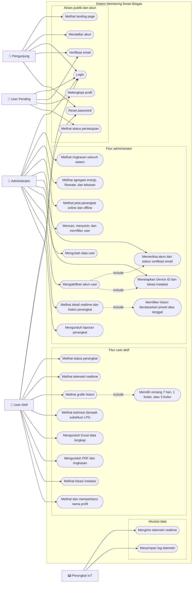
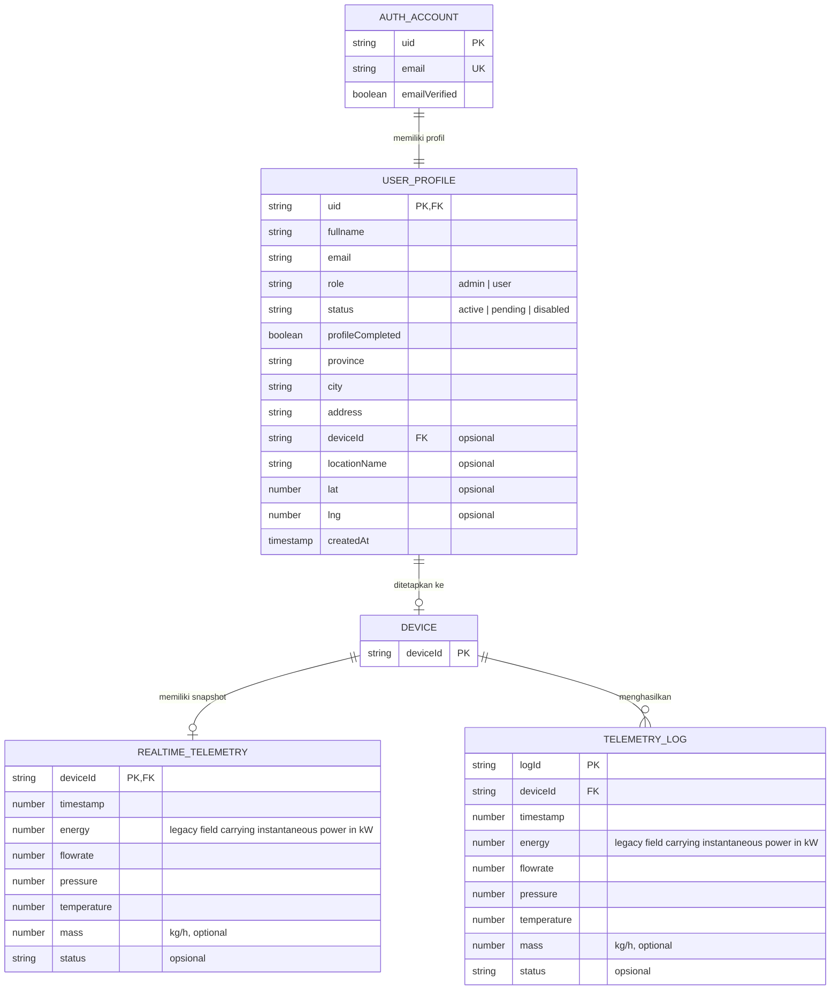

# Use Case dan ERD Smart Biogas

Dokumen ini menggambarkan fitur dan struktur data yang benar-benar digunakan oleh aplikasi saat ini. Sistem memakai Firebase Authentication untuk akun, Cloud Firestore untuk profil pengguna, dan Firebase Realtime Database untuk telemetri perangkat.

## Use Case Diagram

### Aturan akses utama

- User baru dibuat dengan `role = user` dan `status = pending`.
- User hanya memperoleh akses dashboard setelah profil lengkap dan status akun menjadi `active`.
- Aktivasi user mensyaratkan `deviceId`, latitude, dan longitude telah ditetapkan administrator.
- User hanya dapat membaca data perangkat yang tercantum pada claim `deviceId` miliknya.
- Administrator dapat membaca semua profil pengguna dan telemetri perangkat.
- Perangkat IoT hanya dapat menulis ke node realtime dan log dengan `deviceId` yang sama seperti claim perangkat.

## Entity Relationship Diagram

ERD berikut merupakan model konseptual dari penyimpanan NoSQL aplikasi. `DEVICE` direpresentasikan oleh key `deviceId` pada Realtime Database, sedangkan kepemilikannya disimpan melalui atribut `users.deviceId` di Firestore.

## Pemetaan ke Firebase

| Entitas | Lokasi penyimpanan | Kunci |
|---|---|---|
| `AUTH_ACCOUNT` | Firebase Authentication | `uid` |
| `USER_PROFILE` | Cloud Firestore `users/{uid}` | `uid` |
| `DEVICE` | Firebase Realtime Database `biogasData/{deviceId}` | `deviceId` |
| `REALTIME_TELEMETRY` | `biogasData/{deviceId}/realtime` | `deviceId` dari parent node |
| `TELEMETRY_LOG` | `biogasData/{deviceId}/logs/{logId}` | `logId` |

Firmware menggunakan key RTDB `energy` untuk nilai daya sesaat dalam kW. Web menormalisasikannya sebagai `powerKw`, dan tetap membaca `energy` agar sesuai dengan payload perangkat. `deviceId` adalah ID string yang ditetapkan per alat pada profil Firestore; nilai firmware dan profil harus sama persis. Field `mass` bersifat opsional dan berisi laju massa kg/jam.

## Kardinalitas

- Satu akun autentikasi memiliki tepat satu profil pengguna.
- Satu profil user dapat belum memiliki perangkat atau memiliki satu perangkat.
- Satu perangkat ditetapkan kepada satu user pada model aplikasi saat ini.
- Satu perangkat mempunyai satu snapshot realtime dan dapat menghasilkan banyak log histori.
- Administrator tetap disimpan pada entitas `USER_PROFILE`; pembeda aksesnya adalah nilai `role`.
